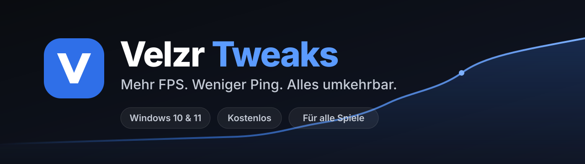
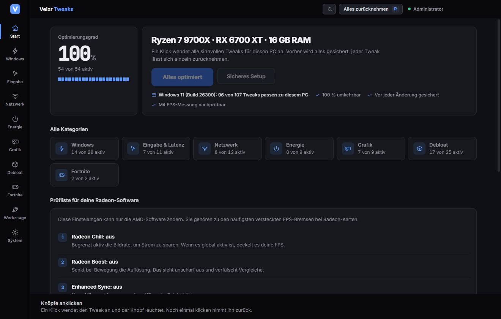
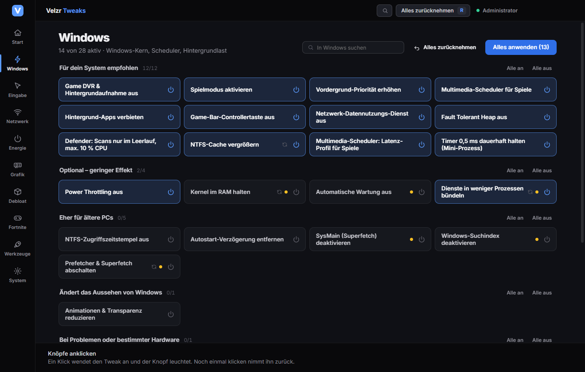
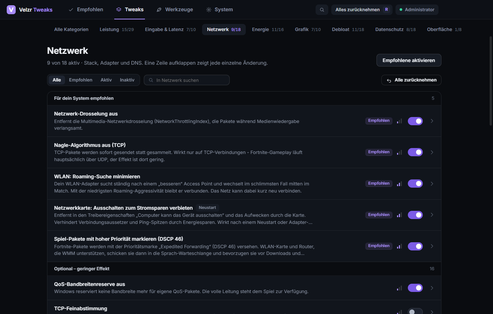
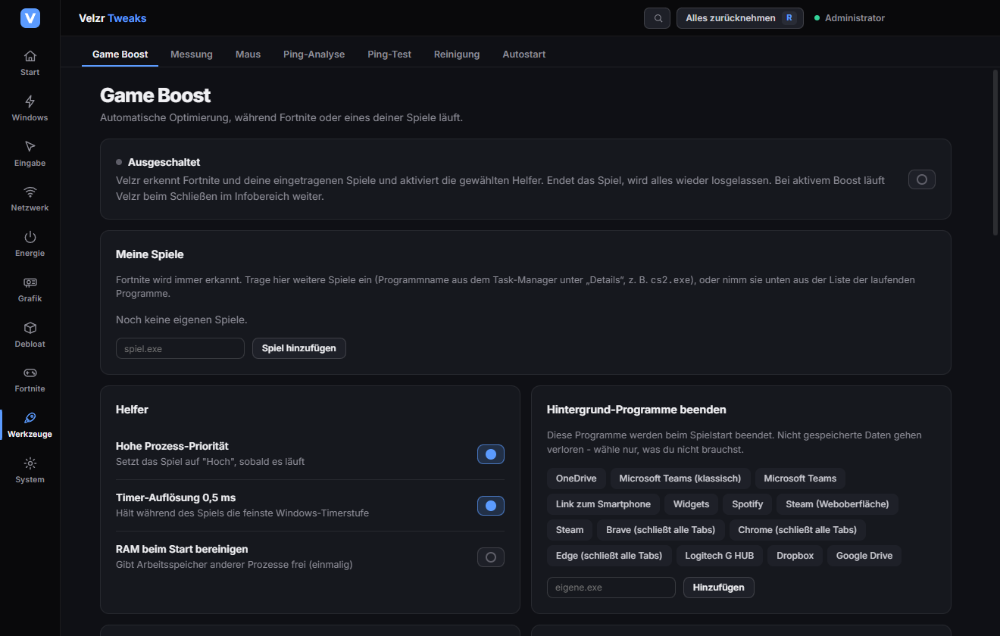
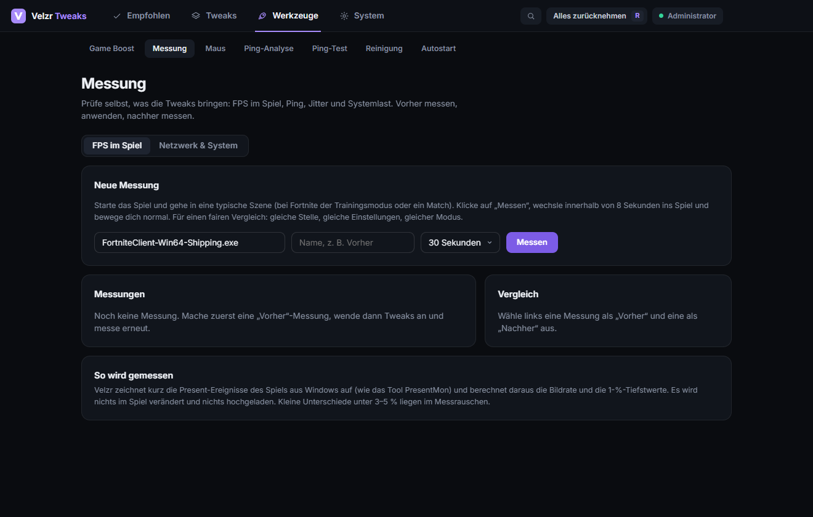
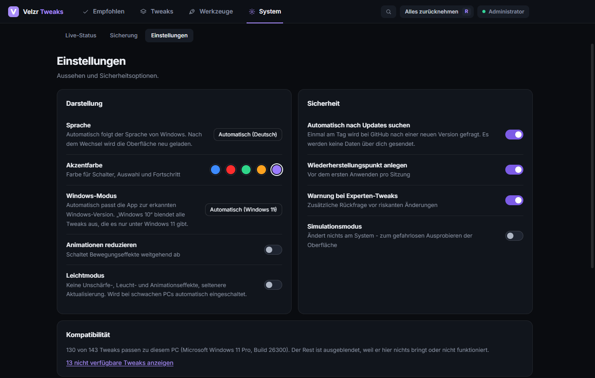

  

  
  
  

<h3 align="center">Hol mehr aus deinem PC heraus. Ohne Risiko, ohne Verkaufsmasche.</h3>

  <a href="https://github.com/xDJMLx/Velzr-Tweaks/releases/latest"><b>⬇ Herunterladen</b></a>
  &nbsp;·&nbsp;
  <a href="#so-startest-du">So startest du</a>
  &nbsp;·&nbsp;
  <a href="#häufige-fragen">Häufige Fragen</a>
  &nbsp;·&nbsp;
  <a href="README.md">English</a>

---

**Velzr Tweaks** stellt Windows für Spiele ein: weniger Hintergrundlast, ruhigere Frametimes, stabilerer Ping, weniger Eingabeverzögerung. Die App erkennt deinen PC (Prozessor, Grafikkarte, Arbeitsspeicher, WLAN, Laptop oder Desktop, Windows 10 oder 11) und schlägt nur das vor, was bei dir etwas bringt. Alles ist vorher gesichert und mit einem Klick rückgängig zu machen.

Die App spricht deine Sprache: Sie startet in der Sprache deines Windows (aktuell Englisch, Deutsch, Spanisch, Französisch, Portugiesisch, Russisch, Polnisch und Türkisch) und nimmt sonst Englisch. Unter Einstellungen kannst du die Sprache jederzeit wechseln.

## Warum Velzr Tweaks?

| | |
|---|---|
| **Alles umkehrbar** | Vor jeder Änderung speichert die App die Originalwerte. „Alles zurücknehmen“ stellt sie wieder her, auch Wochen später. |
| **Passt zu deinem PC** | Keine Standardliste für alle. Ein schwacher Laptop bekommt andere Empfehlungen als ein High-End-Desktop. |
| **Für alle Spiele** | Nicht nur für ein Spiel gebaut. Die Empfehlungen wirken in jedem Spiel. |
| **Du siehst, was es bringt** | Eingebaute FPS-Messung mit Vorher/Nachher-Vergleich, dazu eine Ping-Analyse. Keine Versprechen, sondern Zahlen von deinem PC. |
| **Transparent** | Jeder Tweak lässt sich aufklappen und zeigt genau, welche Einstellung geändert wird. |
| **Privat** | Kein Konto, keine Telemetrie. Es werden keine Daten über dich gesendet. |

## Ergebnisse

| PC | Ergebnis |
|---|---|
| Ryzen 7 9700X · RX 6700 XT, Fortnite (Performance-Modus) | von ca. 350 auf ca. 600 FPS im Durchschnitt |
| Sehr schwacher PC mit Windows 10 | ca. +86 % durchschnittliche FPS |

> **Wichtig:** Das sind Rückmeldungen von Testern, keine Labormessungen. Wie viel du gewinnst, hängt von deinem PC, deinen Treibern und dem Spiel ab. **Je schwächer der PC und je mehr Hintergrundlast, desto größer der Gewinn.** Starke PCs gewinnen weniger. Prüfe es selbst mit der eingebauten Messung: ein „Vorher“, Tweaks anwenden, ein „Nachher“.

## Screenshots

<table>
  <tr>
    <td width="50%"> <b>Empfohlen:</b> die Auswahl passend zu deinem PC</td>
    <td width="50%"> <b>Tweaks:</b> übersichtlich nach Kategorien</td>
  </tr>
  <tr>
    <td> <b>Jeder Tweak</b> erklärt, was er ändert</td>
    <td> <b>Game Boost:</b> automatische Optimierung beim Spielstart</td>
  </tr>
  <tr>
    <td> <b>Messung:</b> FPS, Ping und Systemlast vorher und nachher</td>
    <td> <b>Einstellungen:</b> Sprache, Windows-Modus, Leichtmodus, Kompatibilität</td>
  </tr>
</table>

## Was drin ist

- **Empfohlen:** Auswahl nach deiner Hardware, „Sicheres Setup“ als Assistent, Ein-Tasten-Undo.
- **Über 140 Tweaks** in 8 Kategorien: Leistung, Eingabe und Latenz, Netzwerk, Energie, Grafik, Debloat, Datenschutz, Oberfläche. Gruppiert danach, ob sie zu deinem System passen.
- **FPS-Messung** in jedem Spiel (wie PresentMon), mit Durchschnitt, 1 % Low und 0,1 % Low.
- **Ping-Analyse:** zerlegt deinen Ping in WLAN, Internet-Strecke und Verhalten unter Last (Bufferbloat), mit Befund und Vorher/Nachher-Vergleich.
- **Game Boost:** erhöht die Priorität deines Spiels, hält die feine Timer-Auflösung und beendet auf Wunsch Hintergrundprogramme, solange das Spiel läuft.
- **Hardware-Tipps:** Die App zeigt auch, was Software nicht lösen kann, zum Beispiel Single-Channel-RAM oder ein nicht aktiviertes EXPO-Profil.
- **Windows-Updates:** Setzt ein Update Einstellungen zurück, bietet die App „Erneut anwenden“ an.
- **Windows 10 und 11:** Tweaks, die es nur unter Windows 11 gibt, werden unter Windows 10 ausgeblendet.
- **Für schwache PCs:** Leichtmodus, sparsame Hintergrundlast, passende Empfehlungen.
- **Deine Sprache:** folgt automatisch der Windows-Sprache, in den Einstellungen umstellbar.
- Dazu Reinigung, Autostart-Verwaltung, Maus-Werkzeuge und Profile zum Exportieren.

## So startest du

1. **[Velzr-Tweaks-Setup herunterladen](https://github.com/xDJMLx/Velzr-Tweaks/releases/latest)** (Datei `Velzr-Tweaks-Setup-<Version>.exe`).
2. Ausführen. Windows zeigt eine Warnung, weil der Installer nicht digital signiert ist: **„Weitere Informationen“ → „Trotzdem ausführen“**. Die Administrator-Abfrage bestätigen, sie ist nötig, weil die App Systemeinstellungen ändert.
3. Im Tab **Empfohlen** auf **„Sicheres Setup“** klicken. Die App legt einen Wiederherstellungspunkt an und wendet die Auswahl an.
4. Neu starten, spielen, mit der **Messung** prüfen.

Nicht zufrieden? **„Alles zurücknehmen“** (Taste **R**) oder einfach deinstallieren.

## Häufige Fragen

<b>Ist das sicher?</b>

Die App verwendet nur dokumentierte Windows-Einstellungen. Vor jeder Änderung werden die Originalwerte gesichert, vor dem ersten Anwenden legt sie auf Wunsch einen Windows-Wiederherstellungspunkt an. Tweaks mit Nebenwirkungen sind als „Experte“ oder „Abwägung“ gekennzeichnet und gehören nicht zur normalen Empfehlung.

<b>Kann ich damit gesperrt werden (Anti-Cheat)?</b>

Die App verändert keine Spieldateien und greift nicht in Spiele, Anti-Cheat-Systeme oder den Netzwerkverkehr im Spiel ein. Sie ändert Windows-Einstellungen, die jeder auch von Hand setzen kann. Es gibt bewusst keine Funktionen, die Trefferregistrierung oder Spielmechaniken beeinflussen.

<b>Warum braucht die App Administratorrechte?</b>

Weil Windows-Einstellungen wie Dienste, Energiepläne und Systemregistrierung nur mit Administratorrechten geändert werden dürfen. Ohne sie kann die App nur anzeigen.

<b>Warum warnt Windows beim Installieren?</b>

Der Installer ist nicht digital signiert (ein Zertifikat kostet Geld). Windows warnt deshalb bei jeder unbekannten Software. Lade ihn nur von dieser Seite herunter. Die Prüfsumme (SHA-256) steht bei jeder Version unter Releases.

<b>Läuft das unter Windows 10?</b>

Ja. Die App erkennt die Windows-Version und zeigt nur Tweaks, die dazu passen. Unter Einstellungen → Kompatibilität steht, welche Tweaks zu deinem PC passen und warum der Rest ausgeblendet ist.

<b>Wie viele FPS bringt das?</b>

Das lässt sich nicht pauschal sagen. Bei schwachen PCs mit viel Hintergrundlast sind große Sprünge möglich, bei starken PCs eher kleine. Oft hilft Hardware mehr, zum Beispiel ein zweiter Arbeitsspeicher-Riegel. Die App misst es für dich, damit du nichts glauben musst.

<b>Was kostet das? Was passiert mit meinen Daten?</b>

Es ist kostenlos. Es gibt kein Konto und keine Telemetrie. Die App fragt einmal am Tag bei GitHub nach einer neuen Version (abschaltbar), die Ping-Messungen sprechen mit Cloudflare und Amazon-Rechenzentren. Mehr nicht.

<b>Wie bekomme ich Updates?</b>

Die App zeigt oben „Update <Version>“, sobald hier unter Releases eine neue Version erscheint. Du lädst sie herunter und führst sie aus. Einstellungen und Sicherungen bleiben erhalten.

<b>Welche Sprachen gibt es?</b>

Aktuell Englisch, Deutsch, Spanisch, Französisch, Portugiesisch (Brasilien), Russisch, Polnisch und Türkisch. Die App wählt automatisch die Sprache deines Windows und nimmt Englisch, wenn deine noch nicht dabei ist (weitere Sprachen lassen sich ergänzen, dazu ein Ticket unter Issues eröffnen). Unter Einstellungen kannst du die Sprache ändern.

## Hilfe und Feedback

Etwas funktioniert nicht oder ein Tweak macht Probleme? Öffne unter **Issues** ein Ticket und hänge die Datei aus **Einstellungen → Diagnose exportieren** an. Sie enthält Programmversion, Systemdaten und Fehlerprotokoll, aber keine persönlichen Daten.

## Hinweis

Velzr Tweaks steht in keiner Verbindung zu Microsoft, Epic Games, AMD, NVIDIA, Intel oder anderen genannten Unternehmen. Alle Marken gehören ihren Inhabern. Die Nutzung erfolgt auf eigene Verantwortung, die vollständigen Bedingungen stehen in der App unter Einstellungen → Über Velzr Tweaks.

---

<a href="CHANGELOG.md">Änderungen (Changelog, English)</a> · <a href="README.md">English</a>

