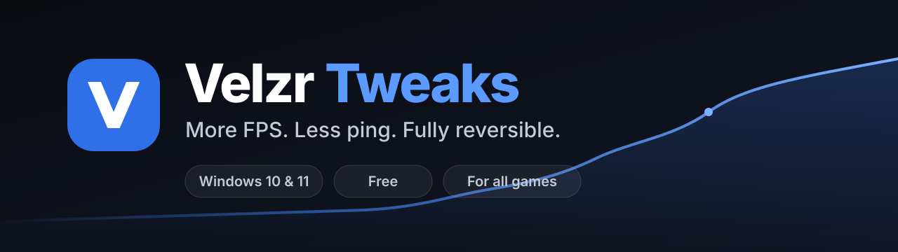
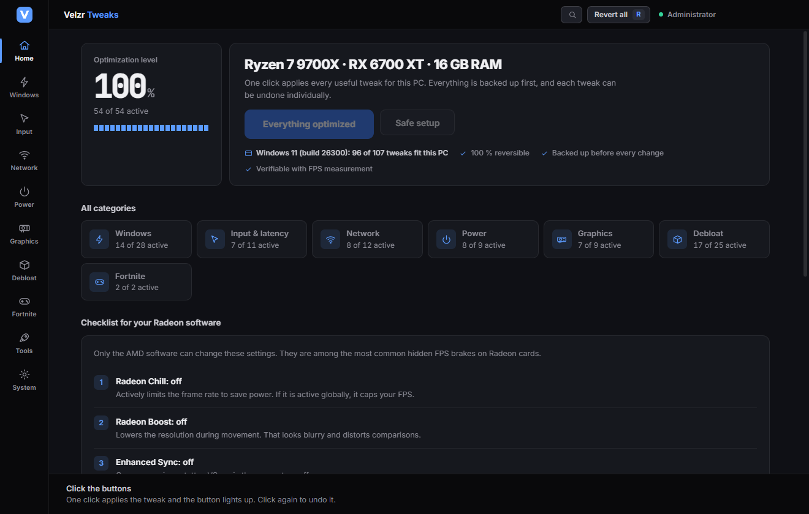
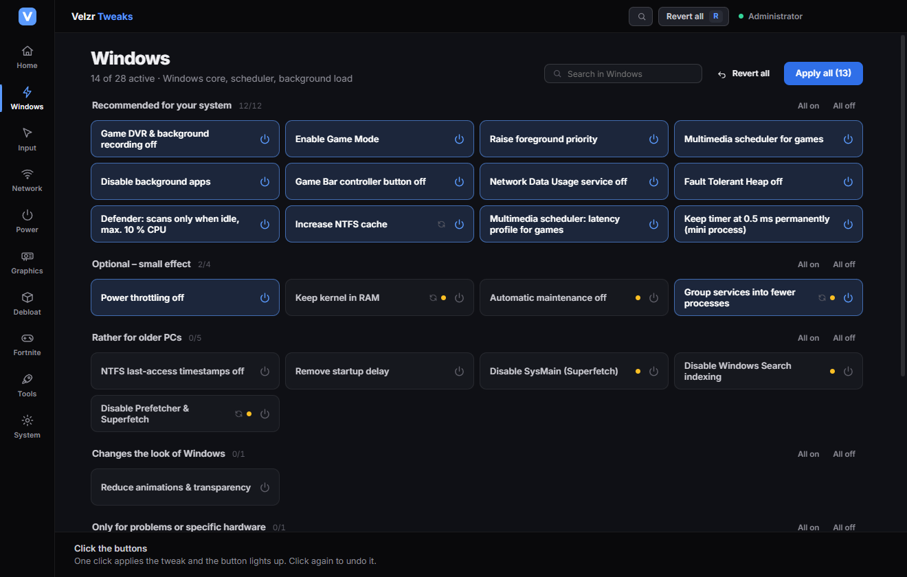
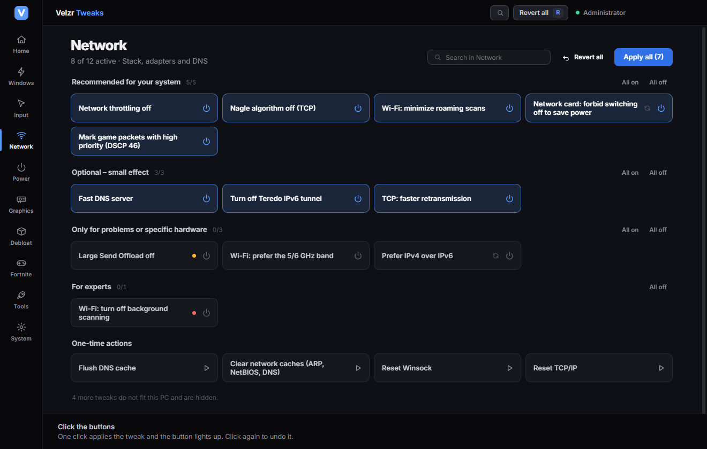
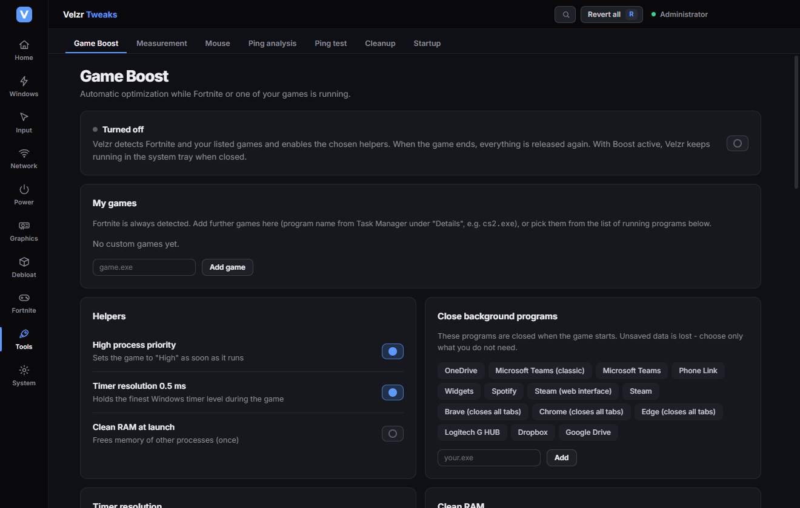
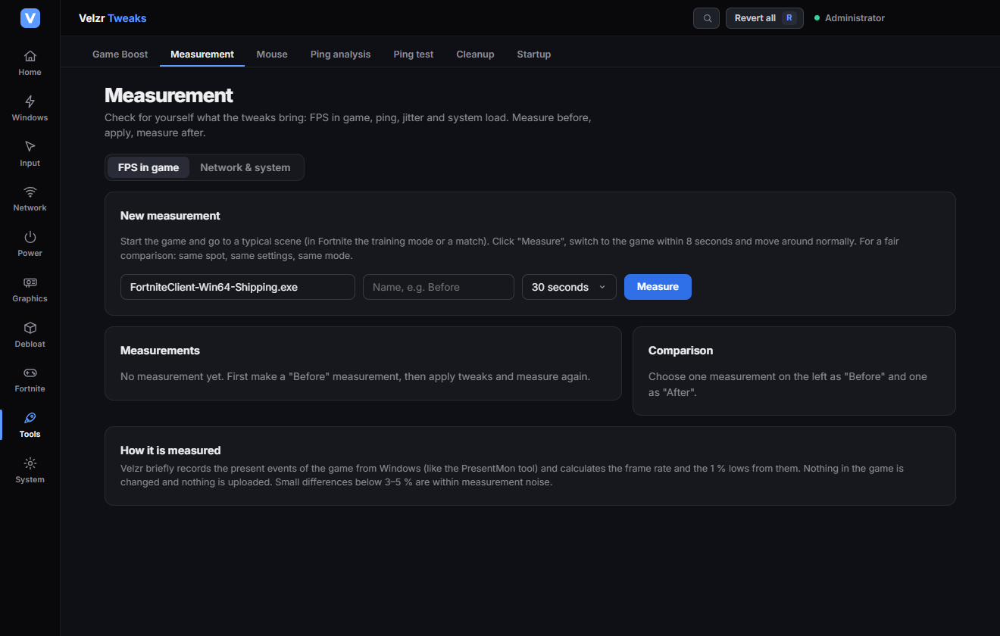
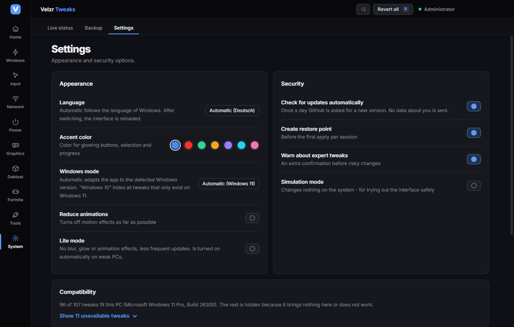

  

  
  
  

<h3 align="center">Get more out of your PC. No risk, no sales pitch.</h3>

  <a href="https://github.com/xDJMLx/Velzr-Tweaks/releases/latest"><b>⬇ Download</b></a>
  &nbsp;·&nbsp;
  <a href="#getting-started">Getting started</a>
  &nbsp;·&nbsp;
  <a href="#faq">FAQ</a>
  &nbsp;·&nbsp;
  <a href="README.de.md">Deutsch</a>

---

**Velzr Tweaks** tunes Windows for gaming: less background load, steadier frame times, a more stable ping and less input lag. The app detects your PC (processor, graphics card, memory, Wi-Fi, laptop or desktop, Windows 10 or 11) and only suggests what actually helps on your machine. Everything is backed up first and can be undone with one click.

The app speaks your language: it starts in the language of your Windows installation (currently English, German, Spanish, French, Portuguese, Russian, Polish and Turkish) and falls back to English otherwise. You can switch the language any time under Settings.

## Why Velzr Tweaks?

| | |
|---|---|
| **Everything is reversible** | Before every change the app stores the original values. "Revert all" restores them, even weeks later. |
| **Fits your PC** | No one-size-fits-all list. A weak laptop gets different recommendations than a high-end desktop. |
| **For all games** | Not built for a single game. The recommendations work in every game. |
| **See what it brings** | Built-in FPS measurement with a before/after comparison, plus a ping analysis. No promises, just numbers from your PC. |
| **Transparent** | Every tweak can be expanded and shows exactly which setting is changed. |
| **Private** | No account, no telemetry. No data about you is sent anywhere. |

## Results

| PC | Result |
|---|---|
| Ryzen 7 9700X · RX 6700 XT, Fortnite (performance mode) | from about 350 to about 600 FPS on average |
| Very weak PC with Windows 10 | about +86 % average FPS |

> **Important:** These are reports from testers, not lab measurements. How much you gain depends on your PC, your drivers and the game. **The weaker the PC and the more background load, the bigger the gain.** Strong PCs gain less. Check it yourself with the built-in measurement: take a "Before", apply the tweaks, take an "After".

## Screenshots

<table>
  <tr>
    <td width="50%"> <b>Recommended:</b> the selection that fits your PC</td>
    <td width="50%"> <b>Tweaks:</b> clearly organized by category</td>
  </tr>
  <tr>
    <td> <b>Every tweak</b> explains what it changes</td>
    <td> <b>Game Boost:</b> automatic optimization when a game starts</td>
  </tr>
  <tr>
    <td> <b>Measurement:</b> FPS, ping and system load before and after</td>
    <td> <b>Settings:</b> language, Windows mode, lite mode, compatibility</td>
  </tr>
</table>

## What's inside

- **Recommended:** a selection based on your hardware, "Safe setup" as a guided wizard, one-key undo.
- **Over 140 tweaks** in 8 categories: performance, input and latency, network, power, graphics, debloat, privacy, interface. Grouped by whether they fit your system.
- **FPS measurement** in any game (like PresentMon), with average, 1 % low and 0.1 % low.
- **Ping analysis:** breaks your ping down into Wi-Fi, internet path and behavior under load (bufferbloat), with findings and a before/after comparison.
- **Game Boost:** raises the priority of your game, holds the fine timer resolution and, if you like, closes background programs while the game runs.
- **Hardware tips:** the app also shows what software cannot fix, for example single-channel RAM or a disabled EXPO profile.
- **Windows updates:** if an update resets settings, the app offers "Apply again".
- **Windows 10 and 11:** tweaks that only exist on Windows 11 are hidden on Windows 10.
- **For weak PCs:** lite mode, low background load, fitting recommendations.
- **Your language:** follows the Windows language automatically, switchable in Settings.
- Plus cleanup, startup manager, mouse tools and profiles you can export.

## Getting started

1. **[Download the Velzr Tweaks setup](https://github.com/xDJMLx/Velzr-Tweaks/releases/latest)** (file `Velzr-Tweaks-Setup-<version>.exe`).
2. Run it. Windows shows a warning because the installer is not digitally signed: **"More info" → "Run anyway"**. Confirm the administrator prompt; it is needed because the app changes system settings.
3. On the **Recommended** tab click **"Safe setup"**. The app creates a restore point and applies the selection.
4. Restart, play, and check the result with **Measurement**.

Not happy? **"Revert all"** (key **R**) or simply uninstall.

## FAQ

<b>Is it safe?</b>

The app only uses documented Windows settings. The original values are stored before every change, and before the first apply it can create a Windows restore point. Tweaks with side effects are marked "Expert" or "Trade-off" and are not part of the normal recommendation.

<b>Can I get banned for it (anti-cheat)?</b>

The app does not change game files and does not interfere with games, anti-cheat systems or in-game network traffic. It changes Windows settings that anyone can also set by hand. There are deliberately no features that influence hit registration or game mechanics.

<b>Why does the app need administrator rights?</b>

Because Windows settings such as services, power plans and the registry can only be changed with administrator rights. Without them the app can only show information.

<b>Why does Windows warn me during installation?</b>

The installer is not digitally signed (a certificate costs money), so Windows warns about any unknown software. Only download it from this page. The checksum (SHA-256) is listed with every release.

<b>Does it run on Windows 10?</b>

Yes. The app detects the Windows version and only shows tweaks that fit it. Under Settings → Compatibility you can see which tweaks fit your PC and why the rest is hidden.

<b>How many FPS does it bring?</b>

There is no general answer. On weak PCs with a lot of background load big jumps are possible, on strong PCs rather small ones. Often hardware helps more, for example a second memory stick. The app measures it for you so you do not have to take anything on faith.

<b>What does it cost? What happens to my data?</b>

It is free. There is no account and no telemetry. The app asks GitHub once a day whether a new version exists (can be turned off), and the ping measurements talk to Cloudflare and Amazon data centers. Nothing else.

<b>How do I get updates?</b>

The app shows "Update <version>" at the top as soon as a new version appears here under Releases. You download it and run it. Settings and backups are kept.

<b>Which languages are supported?</b>

English, German, Spanish, French, Portuguese (Brazil), Russian, Polish and Turkish. The app picks the language of your Windows installation automatically and uses English if yours is not available yet (more languages can be added, see Issues). You can change the language under Settings.

## Help and feedback

Something does not work or a tweak causes problems? Open a ticket under **Issues** and attach the file from **Settings → Export diagnostics**. It contains the program version, system data and the error log, but no personal data.

## Notice

Velzr Tweaks is not affiliated with Microsoft, Epic Games, AMD, NVIDIA, Intel or any other company mentioned. All trademarks belong to their owners. Use is at your own risk; the full terms are in the app under Settings → About Velzr Tweaks.

---

<a href="CHANGELOG.md">Changelog</a> · <a href="README.de.md">Deutsch</a>

